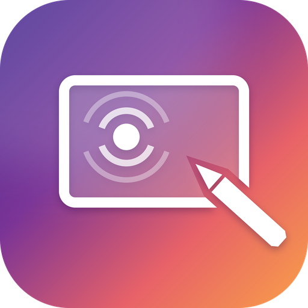

<p align="center">
  
</p>

<h1 align="center">Callido Touch</h1>

<p align="center">
  Touch screen and pen support for macOS.<br>
  A small, free menu bar app that turns a USB touch monitor into clicks, drags, scrolling and pressure-sensitive pen input.
</p>

<p align="center">
  <a href="https://github.com/Niels-van-Haren-Holding-B-V/callido-touch/releases/latest"><b>Download</b></a> ·
  <a href="#install">Install</a> ·
  <a href="#supported-hardware">Hardware</a> ·
  <a href="#build-from-source">Build</a> ·
  <a href="LICENSE">MIT License</a>
</p>

<p align="center">
  A <a href="https://callido.nl">Callido</a> open-source project · <a href="https://callido.dev">callido.dev</a>
</p>

---

macOS has no built-in support for touch screens. Plug in a portable touch monitor and the picture works,
but touching it does nothing. Callido Touch reads the touch screen and the pen and turns them into normal
macOS input.

No kernel extension, no system extension, no driver. Callido Touch reads the panel through Apple's
public HID API and posts regular macOS input events.

## What works

| You do | Mac gets |
| --- | --- |
| Tap | Click (tap twice for a double click) |
| Touch and drag | Click and drag (move windows, select text) |
| Long press | Right click |
| Two-finger drag | Smooth scrolling, with momentum |
| Two-finger tap | Right click |
| Pen hover | Pointer follows the pen |
| Pen down | Click and drag with **pressure and tilt** (works in apps that support tablets) |
| Pen with barrel button | Right click |
| Pen eraser end / eraser button | Eraser tool in apps that support it |

**Pop-up keyboard.** Tap a text field on the touch screen and an on-screen keyboard slides up on that
display. It hides again when you tap something that isn't a text field. Typing on a physical keyboard never
opens it. Turn it off with **menu bar icon → Pop-up Keyboard for Text Fields**, or open it by hand with
**Show Keyboard**.

**Palm rejection.** Touches are ignored while the pen is near the screen, so your palm doesn't click
things while you write.

Not supported (yet): pinch to zoom and rotate. macOS gives apps no public way to create trackpad gestures.
Pull requests that find a reliable way are very welcome.

## Supported hardware

Any touch screen or pen that follows the standard USB HID digitizer specification should work. That
covers almost every touch monitor sold for Windows.

| Device | Touch | Pen | Notes |
| --- | --- | --- | --- |
| Lenovo ThinkVision M14t Gen 2 | ✅ | 🧪 | Development device; pen not yet tested on hardware |

Tried another device? Please open an issue or a pull request so it can be added here
(see [Troubleshooting](#troubleshooting-and-new-devices) for the output to include).

## Install

1. Download `CallidoTouch.dmg` from the [latest release](https://github.com/Niels-van-Haren-Holding-B-V/callido-touch/releases/latest).
   Open it and drag **Callido Touch** to Applications.
2. Open it. The app is not notarized by Apple, so the first time macOS blocks it: open
   **System Settings → Privacy & Security** and click **Open Anyway**.
3. The **Setup** window shows what Callido Touch needs and opens the right settings for you:
   - **Input Monitoring**, to read the touch screen and the pen;
   - **Accessibility**, to click, scroll and type for you.
4. Click **Restart Now** in the Setup window after allowing Input Monitoring. Touch the screen.

The first time Callido Touch opens from `/Applications` it turns on **Open at Login**, so touch keeps
working after a restart. Turn it off under **menu bar icon → Open at Login**. The Setup window is always
available under **menu bar icon → Setup…**.

If touches land on the wrong monitor, choose the right one under **menu bar icon → Touch Screen Display**.
Rotated displays are handled automatically.

### Updating

Download the new release and replace the app in Applications. Releases are signed with the same
certificate every time, so macOS keeps your Accessibility and Input Monitoring permissions.

### Verify a download

Every release has a `SHA256SUMS` file and an Ed25519 signature over it, `SHA256SUMS.sig`, made by the
release pipeline. With the four files in one folder:

```sh
scripts/verify-release.sh v1.0.0 ~/Downloads
```

It checks the signature against the release key below and then the checksums of the downloaded files.

```
Release key (Ed25519): 534b6d336c5ec3bc45876cc07a20a9de776be1b130bd554ed44f10275a777e5e
```

### Coming from another touch driver

Commercial touch drivers (such as UPDD) take exclusive control of the touch screen, so Callido Touch can't
read it while they are installed. Uninstall the other driver first, then unplug and replug the monitor's
USB cable.

## Build from source

You need macOS 13 or newer and Swift 5.10 or newer (Xcode or the Command Line Tools).

```sh
git clone https://github.com/Niels-van-Haren-Holding-B-V/callido-touch.git
cd callido-touch
swift test
scripts/install.sh            # builds, installs to /Applications and starts Callido Touch
```

`scripts/build-app.sh` only builds `build/Callido Touch.app`; `scripts/make-dmg.sh` turns that into a disk
image. A local build is signed ad hoc, so macOS treats each rebuild as a new app: after a rebuild, turn
Callido Touch off and on again under Accessibility (or reset it with
`tccutil reset Accessibility nl.callido.touch`).

## Troubleshooting and new devices

Run Callido Touch from the terminal in dump mode to see exactly what the panel sends, without moving the
pointer:

```sh
"/Applications/Callido Touch.app/Contents/MacOS/CallidoTouch" --dump        # decoded touches and pen samples
"/Applications/Callido Touch.app/Contents/MacOS/CallidoTouch" --dump --raw  # also the raw report bytes
```

The first lines show the device's HID report descriptor. Include that output when you open an issue for a
device that doesn't work.

**Touches show up in `--dump` but nothing clicks:** the Accessibility permission is missing or stale. Open
**Setup…** from the menu bar icon; if it says Accessibility is allowed but nothing happens, remove Callido
Touch from the Accessibility list, add it again and restart the app.

## How it works

```
USB touch panel ──HID reports──▶ HIDService ──▶ DigitizerDecoder ──▶ TouchGestureEngine ─┐
                                 (IOKit)        (descriptor parser)  PenTracker           ├─▶ EventPoster ──▶ macOS
                                                                     DisplayMapper ───────┘   (CGEvent)
```

- **`HIDDescriptor`** parses the panel's HID report descriptor, so Callido Touch knows where X, Y, contact
  IDs, pressure and so on sit in each report. No device-specific code is needed.
- **`DigitizerDecoder`** turns reports into touch frames and pen samples. It also handles "hybrid mode"
  panels that split one frame across several reports, and switches Windows-style panels into multi-touch mode.
- **`TouchGestureEngine`** and **`PenTracker`** decide what a touch means: tap, drag, long press, scroll,
  or pen stroke.
- **`DisplayMapper`** maps panel coordinates onto the right display, taking rotation into account.
- **`EventPoster`** posts mouse, scroll and tablet events with `CGEvent`.
- **`TouchKeyboard`** uses the Accessibility API to see whether a tap focused a text field, and shows a
  keyboard panel that types without taking focus away from the app.

The `CallidoTouchCore` module has no macOS dependencies and is covered by unit tests.

## Contributing

Issues and pull requests are welcome, especially reports from other touch monitors. `main` is protected:
changes go through a pull request, and the `build` workflow (tests, a universal app build and a smoke test)
has to pass. Run `swift test` before opening one. Releases are described in [docs/RELEASING.md](docs/RELEASING.md).

## License and notice

[MIT](LICENSE) © 2026 [Callido B.V.](https://callido.nl) · More open-source tools at [callido.dev](https://callido.dev).

Callido Touch is an independent project. It is not affiliated with, endorsed by or sponsored by any
hardware maker. Lenovo and ThinkVision are trademarks of Lenovo; other product names are trademarks of their
respective owners and are used only to describe compatibility. The logo is original artwork made for this
project.
